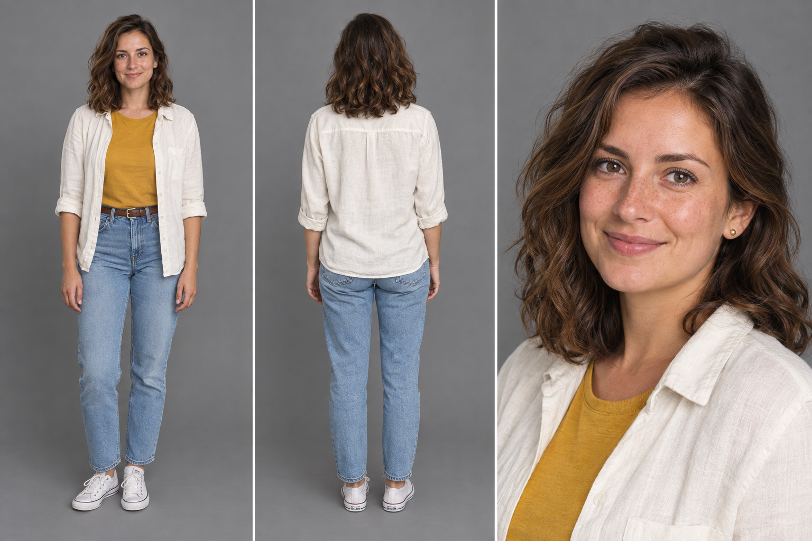
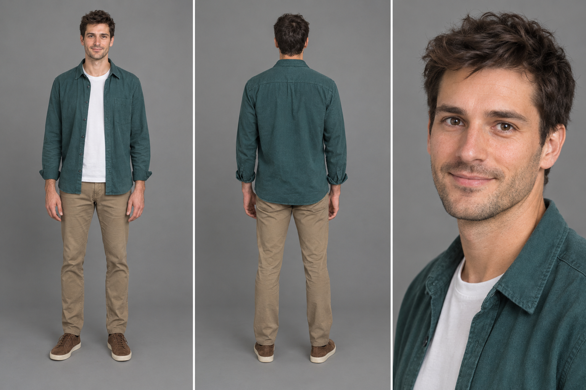
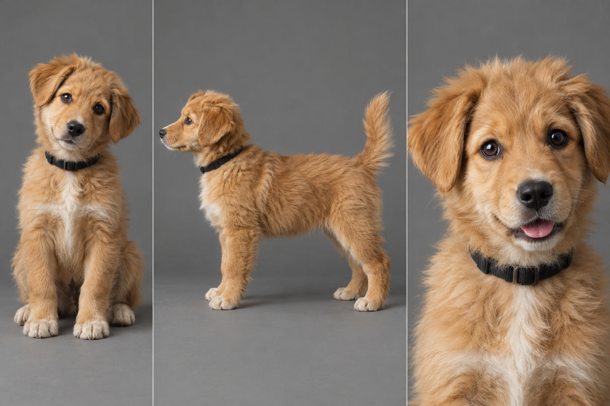

# Postacie

Referencje wgrywamy do generatora z tagami `@ANIA` i `@TOMEK`.
Opisy poniżej to minimalne kotwice. Twarz, sylwetkę i strój i tak niesie zdjęcie referencyjne.

## @ANIA



```text
@ANIA: early 30s slim woman, wavy shoulder-length dark brown hair with caramel ends, light freckles, small gold stud earring, cream linen overshirt with rolled sleeves over a mustard t-shirt, light blue jeans, brown belt, white sneakers. 100% matches the reference.
```

**Głos (wklejać dosłownie, gdy mówi):**

```text
Voice @ANIA: "A 30-year-old Polish woman, soft natural voice with a slight husk; quick, bright delivery, the end of the sentence lifting with playful guilt."
```

**Charakter w dotychczasowych scenach:** ciepła, impulsywna, robi coś pierwsza, a pyta potem. Kiedy się denerwuje, mruga seriami i przeskakuje wzrokiem. Rozbraja uśmiechem.

## @TOMEK



```text
@TOMEK: early 30s lean man, tousled dark brown hair, short stubble, dark teal overshirt open over a white t-shirt, khaki chinos, brown suede sneakers. 100% matches the reference.
```

**Głos (wklejać dosłownie, gdy mówi):**

```text
Voice @TOMEK: "A 30-year-old Polish man, warm low baritone with a slight rasp; relaxed, unhurried delivery; dry and teasing, the joke barely hiding a smile."
```

**Charakter w dotychczasowych scenach:** spokojny i suchy żartowniś. Reaguje bezruchem: przerwana czynność, oczy ruszają się przed głową. Gra dwie prawdy naraz („to zły pomysł” i „już to kocham”).

## @PIESEK



```text
@PIESEK: a 3-month-old fluffy mixed-breed puppy, wavy medium-length honey-gold coat, cream-white bib down the center of the chest, cream paws, soft floppy ears, round dark brown eyes, black nose, plain black fabric collar. 100% matches the reference.
```

**Charakter:** wieczny entuzjasta. Ogon w ruchu, przekrzywia głowę, kiedy coś go ciekawi, a chaos zostawia za sobą 🐶

**Uwaga:** na planszce sierść jest nieco bardziej miodowo-pomarańczowa niż u szczeniaka w klipie z targu (03), gdzie pies był jaśniejszy, kremowo-złoty. Przy ciepłym świetle żarówek na targu ta różnica nie rzuca się w oczy.

## @TOMEK z gitarą i pudłem (przeprowadzka, ujęcia 4–5) ✅

Cała sylwetka Tomka: `referencje/tomek-cala-postac.png` (zrzut 523×1024, oryginał u autora). Edycja w NBP (Flow): gitara w miękkim pokrowcu na plecach, pasek tylko na prawym ramieniu, pudło w obu rękach. Jak na końcu klipu B z u04. **Wynik (11.10):** ✅ `referencje/tomek-gitara-pudlo.jpg`.

## @TOMEK: strój na spacer (ujęcia 7–8, park) ⏳

**Po co:** bohaterowie nie chodzą codziennie w tym samym. Park to inny dzień niż przeprowadzka i kolacja, więc Tomek dostaje drugi zestaw.
**Wybór:** granatowa bawełniana kurtka robocza (chore jacket), rozpięta, na kremowym swetrze z grubego splotu, ciemnografitowe chinosy i **te same brązowe zamszowe trampki** (kotwica postaci). Granat odcina się od złotego tła pod słońce (kolor dopełniający do pomarańczowych liści) i nie zlewa się z liśćmi, jak zrobiłby to rdzawy lub musztardowy. Styl ten sam: luźny, spokojny, bez logo.
**Ustawienia:** Flow · NBP · **3:2** (planszka ma 1536×1024) · 2k · x4. Obraz 1 = `referencje/tomek.png` (planszka: przód, tył, portret).

```text
Edit image 1: the same man in all three panels, dressed in a new autumn outfit.

CHANGE (clothing only, consistent in all three panels):
- Instead of the dark teal overshirt: an unbuttoned dark navy cotton chore jacket with a flat collar, three patch pockets on the front and slightly rolled cuffs, soft matte canvas texture.
- Instead of the white t-shirt: a cream oatmeal crew-neck sweater in a chunky knit, its ribbed hem showing below the open jacket.
- Instead of the khaki chinos: dark charcoal-grey slim chinos, plain matte cotton.
- Plain unbranded clothing, no logos or lettering.

PRESERVE EXACTLY:
- His face, tousled dark brown hair, short stubble, brown eyes, expression and smile in every panel
- The brown suede sneakers with white soles
- Poses, body proportions and positions in all three panels: front full body on the left, back full body in the middle, close-up portrait on the right
- The flat mid-grey studio backdrop, the white panel dividers, soft directional studio light, shadows, colour grade, grain
- Camera framing of every panel

ONLY CHANGE: the jacket, the top and the trousers. 100% identical otherwise.
```

**Na co patrzeć:** ta sama twarz we wszystkich trzech panelach, sweter widoczny pod rozpiętą kurtką, tył kurtki bez nadruku, trampki bez zmian. Zapisz jako `referencje/tomek-park.png`.
